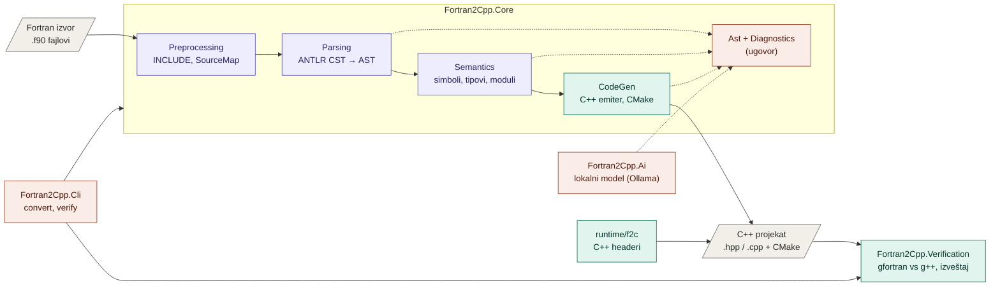

# Fortran2Cpp

Alat za prevođenje podržanog skupa Fortran koda u funkcionalno ekvivalentan C++ kod.

Alat prevodi ceo projekat (više fajlova, module i `USE`), a ne samo pojedinačne funkcije. Generisani kod proverava tako što pokrene originalni Fortran program i njegov prevod na istim ulazima i uporedi izlaze. Na kraju pravi izveštaj: šta je prevedeno, šta je prevedeno uz upozorenje i šta nije podržano.

> Status: u izradi (praksa, 3 nedelje). Plan i podela posla su u [CONTRIBUTING.md](CONTRIBUTING.md).

## Kako radi

```
Fortran izvor → preprocesiranje → ANTLR (CST) → AstBuilder (AST)
             → SemanticAnalyzer (SemanticModel) → C++ emiteri → C++ projekat
             → g++ build → poređenje sa gfortran izlazom → izveštaj
```

1. **Preprocesiranje.** Spajanje linija nastavljenih sa `&` i umetanje `INCLUDE` fajlova. `SourceMap` pamti odakle je došla svaka linija, pa dijagnostike pokazuju originalni fajl i liniju.
2. **Parsiranje.** ANTLR gramatika daje CST (parse tree). `AstBuilder` od njega pravi naš AST: čiste, nepromenljive C# record-e nezavisne od gramatike. Ako se gramatika promeni, menja se samo `AstBuilder`.
3. **Semantička analiza.** `SemanticAnalyzer` pravi tabelu simbola, određuje tipove (uključujući implicitne: imena koja počinju sa I–N su `INTEGER`) i razrešava dvosmislenosti, npr. da li je `a(i)` element niza ili poziv funkcije. Rezultat je `SemanticModel`, koji za svaki čvor kaže na koji simbol se odnosi i kog je tipa. Nepodržani konstrukti (`GOTO`, `COMMON`...) dobijaju dijagnostiku, a ne pogrešan kod.
4. **Generisanje koda.** Emiteri prevode AST u C++. `PROGRAM` postaje `main()`, `SUBROUTINE` postaje `void` funkcija sa argumentima po referenci, a `INTENT(IN)` postaje `const T&`. Uz kod se generiše `CMakeLists.txt` i kopira runtime.
5. **Verifikacija.** Originalni program se kompajlira sa `gfortran`, a prevod sa `g++`. Oba se pokreću na istim ulazima i izlazi se porede.
6. **Izveštaj.** Sve faze upisuju dijagnostike u zajednički `DiagnosticBag`, a iz njega nastaje izveštaj (konzola, JSON, HTML) sa mapiranjem Fortran linija na C++ linije.

### Više fajlova (`MODULE`, `USE`, `INCLUDE`)

- Svi fajlovi u folderu se parsiraju posebno. Prvi prolaz prikuplja šta svaki modul izvozi.
- `ModuleGraph` gradi graf `USE` zavisnosti i topološki određuje redosled obrade. Ciklus je greška sa jasnom porukom.
- `USE A` uvozi simbole modula A, `USE A, ONLY: x` samo `x`, a `USE A, y => x` ih preimenuje. Poštuju se `PUBLIC` i `PRIVATE`.
- Svaki `MODULE A` daje `A.hpp` (`namespace A`, deklaracije) i `A.cpp` (definicije), a `USE A` postaje `#include "A.hpp"`. Eksterne procedure dobijaju zajednički `externals.hpp` sa prototipovima.
- Verifikacija kompajlira i originalni Fortran istim topološkim redosledom, jer gfortran mora prvo da napravi `.mod` fajl modula.

## Arhitektura

Pune strelice prikazuju tok podataka, a isprekidane znače "koristi ugovor".



| Boja | Sloj |
|---|---|
| Ljubičasta | Front-end: razumevanje Fortrana |
| Zelena | Back-end: pravljenje i provera C++-a |
| Narandžasta | Zajedničko: ugovor, CLI, AI |

### Projekti i zavisnosti

| Projekat | Uloga | Zavisi od |
|---|---|---|
| `Fortran2Cpp.Core` | Cela logika prevođenja: preprocesiranje, parsiranje, semantika, generisanje koda | ništa |
| `Fortran2Cpp.Verification` | Pokretanje kompajlera, poređenje izlaza, izveštaj | `Core` |
| `Fortran2Cpp.Ai` | Opcioni lokalni AI (nedelja 3) | `Core` |
| `Fortran2Cpp.Cli` | Konzolna aplikacija, spaja sve delove | sve |

Unutar `Core`, `CodeGen` koristi samo `Ast`, `Diagnostics` i `SemanticModel`, a nikada `Parsing` ili ANTLR tipove.

### Ugovor

`Ast/`, `Diagnostics/` i `Semantics/SemanticModel.cs` čine ugovor između front-end-a i back-end-a:

- **AST:** nepromenljivi record-i, svaki sa `SourceSpan` (fajl, linija, kolona).
- **SemanticModel:** čvor → simbol (promenljiva, procedura, modul) i tip (`Integer`, `Real`, `Double`, `Logical`, `Character(len)`, dimenzije, `Intent`).
- **Diagnostic:** `Severity` (`Info`, `Warning`, `Unsupported`, `Error`), šifra, poruka i `SourceSpan`.

```csharp
public abstract record Node(SourceSpan Span);
public abstract record Expr(SourceSpan Span) : Node(Span);
public abstract record Stmt(SourceSpan Span) : Node(Span);

public sealed record BinaryExpr(BinaryOp Op, Expr Left, Expr Right, SourceSpan Span) : Expr(Span);
public sealed record NameOrCall(string Name, ImmutableArray<Expr> Args, SourceSpan Span) : Expr(Span); // niz ili poziv, razrešava SemanticAnalyzer
public sealed record Assignment(Expr Target, Expr Value, SourceSpan Span) : Stmt(Span);
public sealed record DoLoop(string Var, Expr Start, Expr End, Expr? Step,
                            ImmutableArray<Stmt> Body, SourceSpan Span) : Stmt(Span);
```

### Runtime

`runtime/f2c/` je mala C++ biblioteka (samo headeri) koja se kopira uz svaki generisani projekat. Pokriva ono što Fortran ima, a C++ nema direktno:

- `f2c::Array<T, Rank>`: indeksi od 1 (ili od zadate donje granice), column-major raspored, provera granica u debug modu.
- `f2c::print` / `f2c::read`: `PRINT *`, `WRITE(*,*)` i `READ *`, uz logičke vrednosti kao `T`/`F`.
- `f2c::ipow`: `**` sa celim brojevima.
- Pomoćne funkcije za stringove fiksne dužine (`CHARACTER(len=n)`).
- Intrinsici (`MOD`, `ABS`, `SQRT`, `SUM`...), u nedelji 3.

Primer prevoda:

```fortran
program demo
  implicit none
  integer :: i
  real :: a(5)
  do i = 1, 5
    a(i) = i ** 2
  end do
  print *, a(3)
end program
```

```cpp
#include "f2c/runtime.hpp"

int main() {
    int i;
    f2c::Array<float, 1> a(5);          // indeksi 1..5
    for (i = 1; i <= 5; ++i) {
        a(i) = static_cast<float>(f2c::ipow(i, 2));
    }
    f2c::print(a(3));
}
```

## Podržani skup

| Faza | Konstrukti |
|---|---|
| `[1]` | `PROGRAM`, `SUBROUTINE`, `FUNCTION`, `CONTAINS`, `CALL`; `INTEGER`, `REAL`, `DOUBLE PRECISION`, `LOGICAL`, `CHARACTER`, `PARAMETER`, `IMPLICIT NONE` i implicitni tipovi; statički 1D/2D nizovi; `+ - * / **`, relacioni i logički operatori; `IF / ELSE IF / ELSE`, `DO`, `DO WHILE`, `EXIT`, `CYCLE`; `PRINT *`, `WRITE(*,*)`, `READ *` |
| `[2]` | Više fajlova, `MODULE`, `USE` (`ONLY`, preimenovanje), `PUBLIC`/`PRIVATE`, `INCLUDE`, eksterne procedure |
| `[3]` | Matematički intrinsici (`MOD`, `ABS`, `SQRT`, `SUM`, `MIN`/`MAX`...) |
| Nepodržano | `GOTO`, `COMMON`, `EQUIVALENCE`, `FORMAT`, pokazivači, izvedeni tipovi, fixed-form `[kasnije]`. Prijavljuje se kao `Unsupported`. |

Na šta treba paziti pri prevođenju:

- `REAL` je `float`, a literal `1.0` je single precision (`1.0f`). Double precision je `1.0d0`.
- Broj iteracija `DO` petlje se računa unapred, a promenljiva posle petlje ima vrednost `kraj + korak`.
- Svi argumenti procedura se prosleđuju po referenci.

Detalji i obrazloženja su u [docs/analiza.md](docs/analiza.md) i [docs/odluke.md](docs/odluke.md).

## Verifikacija i testiranje

Glavni metod je diferencijalno testiranje: originalni program i prevod se pokreću na istim ulazima i porede im se izlazi.

```
samples/free-form/bubble_sort/
  main.f90
  inputs/01_typical.txt ...
  expected/01_typical.out ...   ← generiše gfortran, commit-uje se
  test.json                     ← tolerancija, očekivani status ("pass" / "unsupported")
```

- Izlazi se porede token po token. Celi brojevi moraju biti jednaki, realni brojevi se porede sa tolerancijom (npr. 1e-5 za `REAL`, 1e-12 za `DOUBLE PRECISION`), a razmaci se ignorišu. Poredi se i izlazni kod programa.
- Ulazi se biraju ovako:
  - klase ekvivalencije (tipični ulazi);
  - granične vrednosti (0, 1, prazan niz, petlja sa nula iteracija, negativan korak);
  - pokrivenost grana (svaki `IF` u obe grane, proverava se sa `gfortran --coverage` + `gcov`);
  - nasumični ulazi sa fiksnim seed-om.
- `samples/negative/` proverava da alat za nepodržan kod prijavi tačnu dijagnostiku, a ne da pukne.
- Unit i snapshot testovi (xUnit + Verify) čuvaju odobreni AST i generisani C++ za svaki uzorak.

## Opcioni AI

U nedelji 3, lokalni model (Ollama, preko `Microsoft.Extensions.AI`) predlaže čitljivija imena promenljivih, komentare i objašnjenja nepodržanih delova. AI nikada ne piše kod, samo vraća predloge u JSON-u. Alat ih primenjuje deterministički, kroz tabelu simbola, pa ponovo kompajlira i verifikuje. Ako verifikacija padne, ostaje deterministički izlaz. Zato AI ne može da promeni logiku ni matematiku.

## Zahtevi

- .NET 10 SDK
- `gfortran`, `g++`, `cmake`
- (opciono, nedelja 3) [Ollama](https://ollama.com) sa lokalnim modelom

## Korišćenje

> Komande su planirane i mogu se menjati tokom razvoja.

```bash
dotnet build

# prevođenje jednog fajla ili celog foldera
dotnet run --project src/Fortran2Cpp.Cli -- convert samples/free-form/bubble_sort -o out/bubble_sort

# prevođenje + verifikacija + izveštaj
dotnet run --project src/Fortran2Cpp.Cli -- verify samples/free-form/bubble_sort

# testovi (bez E2E testova kojima trebaju kompajleri)
dotnet test --filter "Category!=E2E"
```

## Struktura repoa

Oznake: `[1]` nedelja 1 (jedan fajl), `[2]` nedelja 2 (više fajlova), `[3]` nedelja 3 (intrinsici i AI), `[kasnije]` van plana.

```
Fortran2Cpp/
├── src/
│   ├── Fortran2Cpp.Core/
│   │   ├── Grammar/            Fortran.g4                                        [1]
│   │   ├── Preprocessing/      SourceMap, LineJoiner [1], IncludeResolver [2], FixedFormConverter [kasnije]
│   │   ├── Ast/                AstNodes, SourceSpan                              [1]  ugovor
│   │   ├── Diagnostics/        Diagnostic, DiagnosticBag                         [1]  ugovor
│   │   ├── Parsing/            AstBuilder, SyntaxErrorListener                   [1]
│   │   ├── Semantics/          SymbolTable, SemanticAnalyzer, SemanticModel, UnsupportedDetector [1],
│   │   │                       ModuleGraph [2], Intrinsics [3]
│   │   ├── CodeGen/            CppWriter, TypeMapper, Expr/Stmt/DeclEmitter, CMakeGenerator [1],
│   │   │                       HeaderGenerator [2]
│   │   └── Transpiler.cs                                                         [1]
│   ├── Fortran2Cpp.Verification/  CompilerRunner, OutputComparer, Verifier, Report/  [1]
│   ├── Fortran2Cpp.Ai/                                                           [3]
│   └── Fortran2Cpp.Cli/        Program.cs                                        [1]
├── runtime/f2c/                runtime, array, io, ops [1], intrinsics [3]
├── samples/                    free-form/, negative/ [1], multi-file/ [2], fixed-form/ [kasnije]
├── tests/Fortran2Cpp.Tests/    Parsing/, Semantics/, CodeGen/, Verification/, EndToEnd/
└── docs/                       analiza.md, odluke.md
```

## Tim

Anja i David, uz mentore. Ko šta radi i plan po nedeljama su u [CONTRIBUTING.md](CONTRIBUTING.md).
